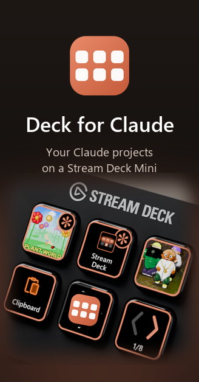
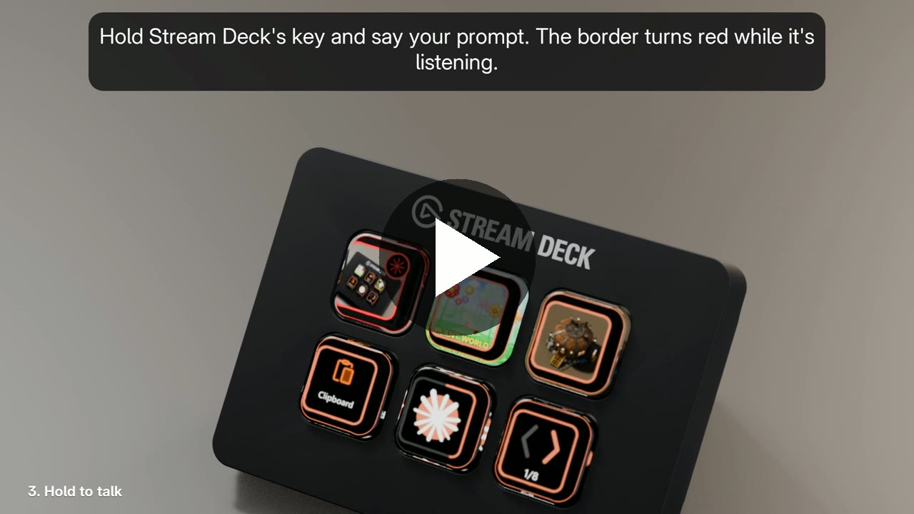

# Deck for Claude

Your Claude projects on an Elgato Stream Deck Mini.

## Tutorial video

A three-minute walkthrough of every key and gesture (tap, double tap, triple tap and hold), with captions
and the Claude voice.

## What the keys do

- **Top row:** the three Claude projects you use most, each with its own picture. Hold a key and talk to
  send that project a voice message (transcribed on your PC with Whisper), or tap and speak.
- **Bottom row:** a General key (its border shows your plan usage; double tap to attach a screenshot),
  a Clipboard key that sends what you've copied, and a pager for more projects.
- **Badges:** a spinner while Claude is working, a flashing **?** when a project is waiting for you (press
  to hear the question and answer it), a stopwatch when work is running in the background (the border
  fills as it nears its ETA), and a speaker when a result is ready to read out.

## Install

1. Download **DeckForClaude-Setup-1.0.0.exe** from the [latest release](../../releases/latest).
2. Run it. No admin rights are needed. By default it starts when you sign in to Windows.
3. Right-click the orange tray icon, choose **Sign in to Claude**, then turn Deck for Claude on.

Turning it on backs up your Stream Deck's first page and puts the Deck for Claude keys there. Turning it
off, or uninstalling (Settings > Apps), puts your original keys back.

## Requirements

- Windows 10 or 11, 64-bit
- The Elgato Stream Deck app and a Stream Deck Mini
- A claude.ai account

## Unofficial

Deck for Claude is an independent, unofficial project. It is not made, endorsed or supported by
Anthropic or by Elgato (Corsair). Claude is a trademark of Anthropic. Elgato and Stream Deck are
trademarks of Corsair Memory, Inc.

Provided as is, without warranty of any kind. The source code is not published here.
